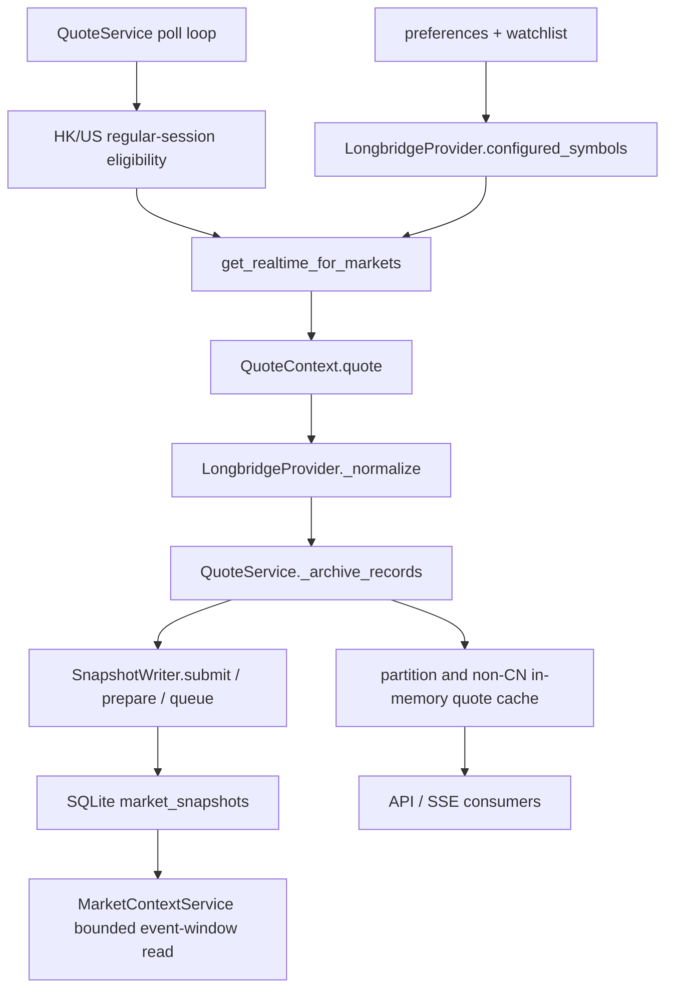
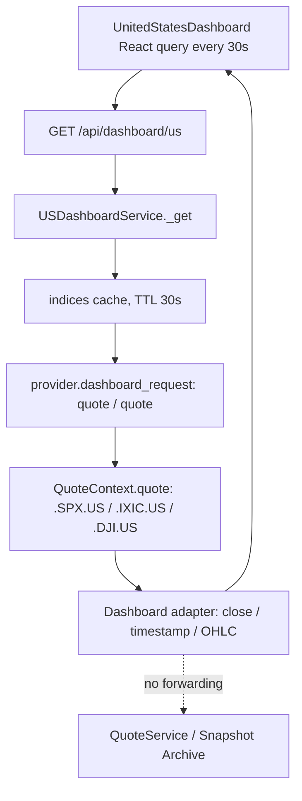
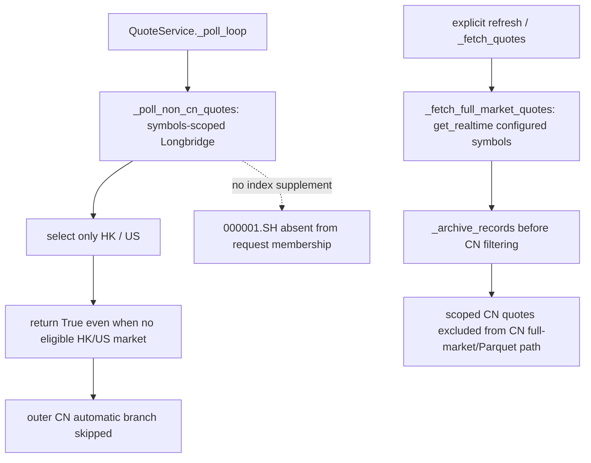

# Benchmark Snapshot Archive Production Path Audit v1

## Scope and evidence boundary

Read-only audit on 2026-10-14, starting from main/
56e6bf74fce53efbaf96e97accc46d5626d7c403, clean/staged empty. Production code, policy,
calendar, quantity semantics, detector and benchmark identities were not changed.
No backend/frontend full suite is required for this documentation-only change.

Current request/configuration gaps are proven. The complete historical cause of the two
zero-count archives is PARTIAL, not a proven single-cause failure: this audit has no natural
running-service request/receipt/writer correlation trace. One-shot SDK responses and pure
prepare() calls below are real read-only diagnostics, not production archive observations.
No snapshots, anomalies, contexts or factor results were created or backfilled.

## Real local storage and ordinary equity control

Runtime root: project `data/user_data/`. Archive: `market_snapshots.sqlite3`; existing file,
queried using SQLite mode=ro. Event DB: `anomaly_engine.sqlite3`, also mode=ro.

| Symbol / dataset | Rows | Evidence |
| --- | --- | --- |
| CN 000001.SH | 0 | exact symbol count before and after probes |
| US .SPX.US | 0 | exact symbol count before and after probes |
| AAPL.US | 911 | provider=longbridge, market=US |
| 700.HK | 3245 | ordinary-security control coverage |
| NVDA.US | 0 | not claimed as a successful archived control |
| 600519.SH | 0 | CN ordinary-security coverage also insufficient |
| anomaly_events | 0 | no real event available for Market Context replay |

AAPL.US received-time range: 2026-10-12T13:30:06.937Z through
2026-10-12T15:59:12.297Z. Latest control row ID 4156 has price 339.836,
quote_timestamp=1791820752000, receive_timestamp=1791820752297, provider=longbridge,
market_session_state=regular, quality_state=unknown, warnings volume_unknown and
volume_unit_unknown, volume=null, volume_unit=unknown. This proves stored real control
coverage, including preservation of unknown quantity; it is not a new live observation.
The archive does not store instrument-type or historical subscription-origin metadata.
Current control configuration membership matches the code path, but the exact historical
request-to-row identity cannot be reconstructed from this row alone.

## Registration, request membership and transport

`plugins/longbridge/plugin.yaml` registers LongbridgeProvider, realtime only. The custom
loader `_load_builtin_plugins` / `_register_one_plugin` checks availability and instantiates
the configured provider. Live read-only inspection of the registry found:

- effective realtime provider: longbridge; class LongbridgeProvider; realtime registered;
- realtime_snapshot_scope=symbols; no callable get_realtime_indices;
- realtime enabled in preferences; three configured symbols, one each in CN/HK/US;
- watchlist has zero symbols;
- AAPL.US and 700.HK are in explicit configuration;
- 000001.SH and .SPX.US are in neither explicit configuration nor watchlist.

`LongbridgeProvider.configured_symbols()` merges longbridge_realtime_symbols and watchlist,
deduplicating symbols accepted by market_from_symbol. It does not automatically add
Dashboard index constants or Market Context benchmarks. get_realtime_for_markets filters
that list by requested markets. These are polling request memberships, not proof of an
SDK streaming subscription. No application set_on_quote/SDK subscribe callback exists in
the inspected Longbridge/QuoteService path: get_realtime calls QuoteContext.quote(chunk).
QuoteService.subscribe is an application SSE subscriber, not provider index subscription.
The SDK may use a persistent network transport internally; that does not join these paths.

## A. Ordinary quote and archive paths

QuoteService `_archive_records` runs before partitioning, non-CN cache filtering and CN
Parquet/full-market filtering. It needs nonempty normalized records and a repository whose
store has data_dir. It submits to the existing four-batch writer queue, catching failures
to protect the quote path. The bool from submit is not promoted to a per-symbol diagnostic.
SnapshotWriter prepares at receipt time and writes asynchronously. No alternate archive
provider or backfill exists here.

## B. US Dashboard index path

`us_dashboard_service.INDEX_SYMBOLS` pins .SPX.US, .IXIC.US, .DJI.US. `_get.quotes()` calls
dashboard_request directly. The provider reuses its SDK context and lock, but not its
get_realtime normalizer or QuoteService consumer. Dashboard rows use close rather than
last_price and cannot simply be passed to archive as normalized records. This bypass is
PROVEN in code. It also applies to Dashboard sample/universe acquisition; those display
requests are not evidence that the QuoteService request universe contains their symbols.

Combined with actual configured membership=false for .SPX.US, the current automatic
QuoteService US request set omits the benchmark. There is no configured index supplement
for a symbols-scoped provider. This is independent of whether the Dashboard is open.

## C. CN benchmark path, independently audited

The automatic loop enters CN fetching only if _poll_non_cn_quotes returns false. For the
active symbols-scoped provider it returns true, including when markets is empty. Its
market list is HK/US only; no CN archive request is made by this loop. Separately, manual
_fetch_full_market_quotes calls provider.get_realtime and archives records before removing
CN rows from the full-market/quantity-unsafe processing path. CN quantity fail-closed is
therefore not a SnapshotArchive index filter.

Scoped providers also set fetch_indices=None, so generic get_realtime_indices supplementation
does not run; Longbridge currently does not implement that method anyway. 000001.SH is absent
from configured symbols. Both current routing/membership exclusions are proven; US-style
Dashboard bypass is not assumed to be the CN reason.

CN Dashboard/side index reads use QuoteService.get_index_quotes. When its index cache is
empty, `/api/intraday/indices` and overview `_index_quotes` use local kline_index_daily as
display fallback. That historical close is not a realtime archive observation and is not
forwarded to SnapshotArchive. No daily fallback or regulatory 399107 substitution is used
as benchmark evidence by this audit.

## One-shot real provider and pure normalization validation

At 2026-10-14T04:42:52Z (12:42 Shanghai / 00:42 New York), three separate, finite
read-only QuoteContext.quote requests used the existing provider's credential mechanism.
No credential values, auth headers or exception dumps were output. TradeContext was not used.

| Requested / returned symbol | SDK response | Normalized rows | prepare rows | Receipt session | Quality |
| --- | --- | --- | --- | --- | --- |
| .SPX.US | list / SecurityQuote | 1 | 1 | closed | unknown: quantity only |
| 000001.SH | list / SecurityQuote | 1 | 1 | break | unknown: quantity only |
| AAPL.US | list / SecurityQuote | 1 | 1 | closed | unknown: quantity only |

Quote timestamps: .SPX.US=1791925410000, 000001.SH=1791952411000,
AAPL.US=1791921600000. `_normalize` produced symbol, market, last_price, prev_close,
open/high/low, amount, change_pct, Unix-ms timestamp, nullable currency/name and null volume.
prepare() accepted each actual response without writing. This proves current snapshot pull
access and parser/prepare compatibility, not streaming entitlement, current regular-session
freshness or a natural QuoteService→writer delivery. Static instrument type was not separately
probed; no instrument-type field is required/stored by this archive. Symbols were returned
exactly as requested, with no alias/fallback. Currency/name metadata is optional to archive.

No current data-source/entitlement blocker was observed for these pulls. No generic claim
about all indices, streaming permissions, sessions or future entitlement is made.

## Complete gate inventory and attribution

PASS below means the stated local stage accepted observed input, not that a missing
benchmark traversed every production stage. UNKNOWN means no natural runtime trace.

| Layer / actual condition | Equity control | 000001.SH | .SPX.US |
| --- | --- | --- | --- |
| provider registration / realtime availability | PASS | PASS | PASS |
| current configured/watchlist request membership | PASS | FAIL | FAIL |
| automatic market selection, symbols source | HK/US only | FAIL: not selected | session-dependent; closed at probe |
| provider SDK pull response and exact symbol | PASS | PASS | PASS |
| batch response list/tuple, symbol belongs to chunk | PASS | PASS in one-shot | PASS in one-shot |
| normalizer price finite and >0 | PASS | PASS in one-shot | PASS in one-shot |
| normalizer datetime, positive Unix-ms timestamp; numeric OHLC fields parse | PASS | PASS in one-shot | PASS in one-shot |
| optional static_info failure | non-dropping | N/A to prepare | N/A to prepare |
| QuoteService nonempty records + repo/store.data_dir | historical rows exist | UNKNOWN natural attempt | UNKNOWN natural attempt |
| writer not closed, queue <4 batches, rows <=20,000 | historical write succeeded | UNKNOWN natural attempt | UNKNOWN natural attempt |
| received_at is timezone-aware; batch bound | PASS | PASS pure prepare | PASS pure prepare |
| established market_from_symbol, symbol length <=128 | PASS | PASS | PASS |
| equity-only/instrument-type inclusion gate | N/A: absent | N/A: absent | N/A: absent |
| explicit market declaration conflict | diagnostic, not archive drop | correct market in real normalization | correct market in real normalization |
| provider/source allowlist gate in archive | N/A: absent; provider label retained | N/A | N/A |
| price/OHLC quality validation in archive | annotate; do not drop | PASS prepare; annotation retained | PASS prepare; annotation retained |
| timestamp future/stale/closed-session quality | annotate; do not drop | PASS prepare during break | PASS prepare while closed |
| volume or unknown units gate | no drop/conversion | null/unknown | null/unknown |
| archive market-session gate | N/A: state recorded | break recorded in pure prepare | closed recorded in pure prepare |
| duplicate quote suppression in archive | N/A: each insert gets new ID | N/A | N/A |
| SQLite path/locking/disk/transaction success | historical rows prove past writes | UNKNOWN: no attempted production write observed | UNKNOWN: same |
| post-archive partition/cache/final/CN quantity filters | downstream | cannot remove an already submitted archive row | same |
| Market Context regular/freshness/quality/window gate | separate downstream check | no archived benchmark window | no archived benchmark window |

Archive `_number` retains finite decimal text or null; invalid/nonpositive price is not
itself an archive drop gate (the provider normalizer rejects nonpositive last price first).
Quality checks annotate unknown/invalid/stale values; exceptions become quality_check_unknown.
Invalid symbol/unknown market is skipped. Received-time/session preparation failures can abort
a batch. Writer close/overflow/full queue rejects batches; persistence errors log a sanitized
warning and do not retry that batch. No schema-level quote uniqueness constraint exists.

Market Context is stricter than persistence: exact symbol/market and bounded quote/receipt
windows, no future observations, quote<=receipt, <=120s receipt latency, acceptable quality
warnings, regular session with no conflict diagnostic, boundary tolerance 30s and maximum gap
120s. It never calls a provider or turns a current quote into a historical boundary. Storage
acceptance while closed does not make the stored row valid event-window market evidence.

## Logs and natural runtime observation limits

Existing backend.log / backend.log.1 were read through sanitized category counters only.
They contain archive-write/full-queue warnings (25/25 and 12/11 respectively), alongside
other errors and benchmark mentions. These logs have no per-benchmark request/writer
correlation and can include test/diagnostic activity. Their counts cannot establish a
production benchmark drop or loss rate. No raw log/auth payload was printed.

No listener was returned for checked local ports 3311/3318/8000/5173. This limited port
check is not a global claim that no server exists on another address/port. No service was
started and no preferences were changed. At the one-shot window CN was at lunch and US
closed. REAL-TIME OBSERVATION of a natural regular-session request→archive delivery was
UNAVAILABLE DURING VALIDATION WINDOW. Historical subscription changes and writer counters
at the AAPL control time are not retained, so the whole historical zero-count cause remains
PARTIAL. The one-shot probes did not increase either benchmark count.

## Root-cause classification and repair decision

| Market | Overall historical zero-count confidence | Proven current exclusions | Not proven |
| --- | --- | --- | --- |
| CN | PARTIAL | request membership gap; symbols-scoped automatic HK/US-only branch skips CN; scoped index supplement disabled | which historical/manual requests occurred; natural writer attempt/outcome; runtime accumulation contribution |
| US | PARTIAL | request membership gap; Dashboard direct-SDK display path bypasses normalizer/QuoteService/archive | historical request membership; natural periodic benchmark request/writer trace; runtime accumulation contribution |

No identity mismatch, archive equity-only filter, archive freshness/session rejection or
provider pull entitlement failure was observed as the cause. These must not be reported
as proven negative root causes merely because they were possible hypotheses.

No production code fix is made: the audit proves missing wiring but does not meet the
requested PROVEN end-to-end production root-cause threshold. Adding subscriptions or
changing CN polling now would make a new production behavior choice without a correlated
natural runtime trace. There are no post-fix archive results. Pure prepare() on actual
SDK responses is a read-only contract probe, not a fixture or a successful archive write.
No fixture was used in this audit, and no tests/build/full regression were rerun.

## Recommended next stage

Use a bounded, explicit diagnostic window on the existing service in each market's regular
session. Capture only symbol/market/timestamps plus requested/returned/normalized/submitted/
accepted counters, with writer failures separately attributed. Do not change preferences,
gates or fabricate traffic to claim a natural path. If a code wiring repair is then proven,
reuse the existing provider→QuoteService→SnapshotArchive consumer and test CN/US separation,
normal equities, unsupported symbols, timestamp/quality handling, queue/dedup semantics and
Market Context read windows. Keep CN Parquet quantity protection and Market Context mathematics
unchanged. Do not introduce a second loop/provider or regulatory benchmark.

No new GitHub project was consulted: current code and local read-only evidence were sufficient
for this audit. No external code/dependency was copied or introduced (code copied: NO).
